# ⚓ SWP Shipyard — 조선소 통합관리 시스템

**설계부터 인도까지, 조선소 운영을 한곳에서.** 호선·공정·실적·도면·결재·회원을 하나의 웹 앱에서 관리하고, Unity 3D 조선소와 로컬 LLM 챗봇(MCP)을 붙였다.

명세(`specs/`)와 참고 화면(`reference/ui/`)만 보고 Claude Code가 **6개 세션, 30개 작업**으로 처음부터 구현했다.

| | |
| --- | --- |
| Backend | FastAPI · SQLite · Argon2id · JWT · TOTP(OTP) · openpyxl/PDF 보고서 |
| Frontend | Vue 3 · Vite · Vitest · 브라우저 내장 PDF 뷰어 |
| 3D | Unity 6 Web(WebGL) — 호선 디지털 트윈 · 3D 조선소 |
| AI | Ollama `qwen2.5:1.5b-instruct`(로컬) + MCP stdio 서버(데이터 조회 전용) |
| 검증 | backend 100 · frontend 68 테스트 통과, Playwright 화면 시나리오 52개 |

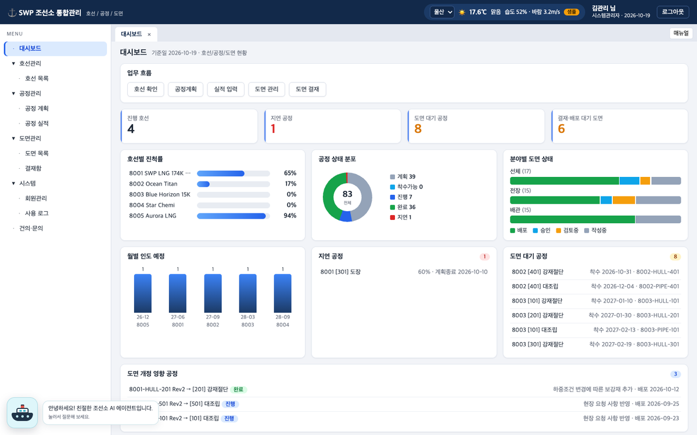

---

## 목차

1. [기능](#기능)
   - [로그인·OTP·회원가입](#1-로그인--otp--회원가입)
   - [대시보드](#2-대시보드)
   - [호선 관리 + 3D 조선소](#3-호선-관리--3d-조선소)
   - [공정 계획(간트)](#4-공정-계획-간트)
   - [공정 실적](#5-공정-실적)
   - [도면 관리](#6-도면-관리)
   - [결재함](#7-결재함)
   - [회원관리·메뉴 권한](#8-회원관리--메뉴-권한)
   - [사용 로그](#9-사용-로그)
   - [건의·문의](#10-건의문의)
   - [조선소 챗봇(MCP + 로컬 LLM)](#11-조선소-챗봇-mcp--로컬-llm)
   - [업무 매뉴얼](#12-업무-매뉴얼)
   - [조회 전용 권한](#13-조회-전용-권한)
   - [공통 셸](#공통-셸)
2. [아키텍처](#아키텍처)
3. [토큰을 아낀 방법](#토큰을-아낀-방법)
4. [실행](#실행)

---

## 기능

> GIF는 실제 앱을 Playwright로 조작하며 찍은 프레임이다(빨간 점 = 마우스). 재현: `docs/tour-flows.json`.

### 1. 로그인 · OTP · 회원가입

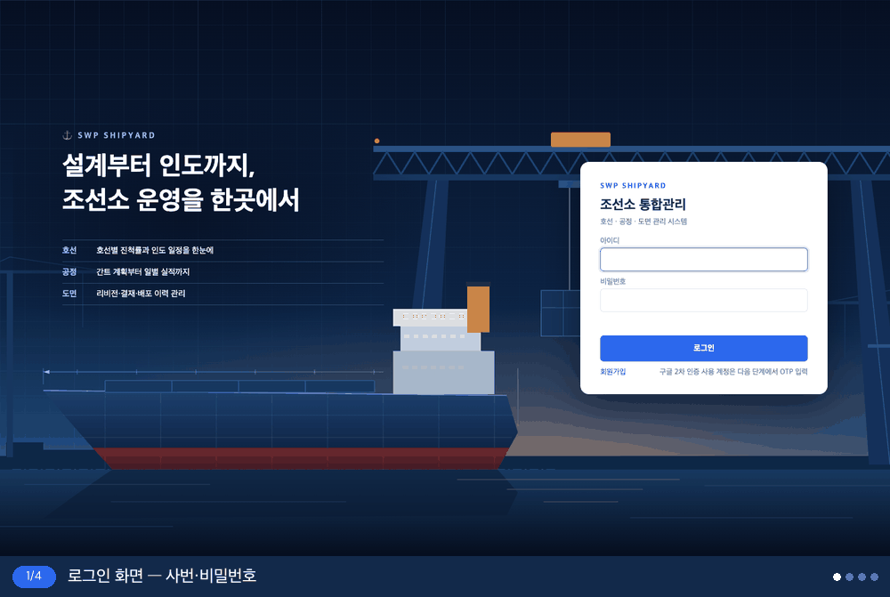

- **사번 + 비밀번호 로그인.** 비밀번호는 Argon2id로 저장, 세션은 JWT(HS256). 계정이 없든 비밀번호가 틀리든 같은 문구(`아이디 또는 비밀번호가 올바르지 않습니다.`)로 응답해 계정 존재 여부를 노출하지 않는다.
- **Google OTP 2차 인증(TOTP, RFC 6238).** OTP를 켠 계정은 1차 인증 토큰만으로는 어떤 보호 API도 호출할 수 없다. 6자리·30초·±1 step, **이미 쓴 코드 재사용 거절**, 토큰당 5회 실패 시 잠금(429).
- **회원가입 신청.** 성명·생년월일·연락처·이메일·사번·비밀번호 확인까지 검증하고, 가입 후에는 `pending` 상태라 관리자 승인 전까지 로그인할 수 없다. 대기·반려·중지 계정은 각각 안내 문구가 다르다.
- **접근 로그.** 로그인마다 접속 기록(사용자·시각·IP)이 남고, 로그아웃하면 그 토큰은 즉시 401이 된다.
- 모바일 폭(390px)에서도 카드 레이아웃이 깨지지 않는다.

### 2. 대시보드

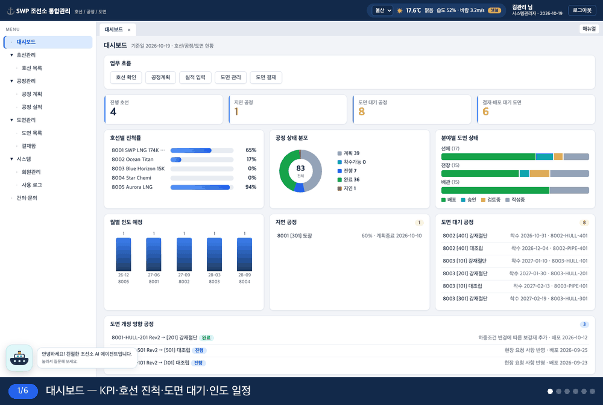

- **KPI 4종**: 진행 호선 · 지연 공정 · 도면 대기 공정 · 결재/배포 대기 도면. 클릭하면 해당 화면으로 이동.
- **호선별 진척률** 막대 — 호버하면 진척 카드, 클릭하면 그 호선으로.
- **공정 상태 분포 도넛**(계획·착수가능·진행·완료·지연) — 구간별 호버 강조.
- **분야별 도면 상태 스택**(선체·전장·배관 × 배포·승인·검토중·작성중).
- **월별 인도 예정** 막대, **지연 공정**, **도면 대기 공정**(7건 이상이어도 6건만 보이고 건수는 전체), **도면 개정 영향 공정**(최근 30일 배포 Rev가 진행·완료·지연 공정에 미치는 영향).
- **업무 흐름 버튼**(호선 확인 → 공정계획 → 실적 입력 → 도면 관리 → 도면 결재): 누르면 해당 단계의 업무 매뉴얼이 열린다. 권한 없는 단계는 버튼이 보이지 않는다.
- 실적이 100%가 되거나 필수 도면이 배포되면 집계가 즉시 바뀐다.

### 3. 호선 관리 + 3D 조선소

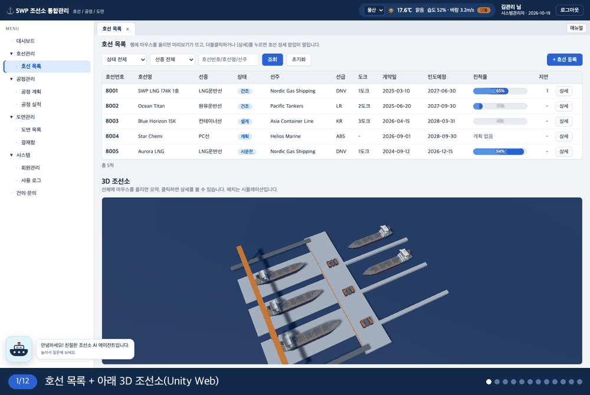

- **호선 목록**: 상태·선종 필터, 검색, 초기화, 행 더블클릭으로 상세. 진척률 막대와 지연 공정 수 표시.
- **마우스오버 미리보기 카드**: 선주·선급·주요 일정·공정 상태 집계를 띄운다(모든 화면이 같은 공통 `HoverCard` 컴포넌트를 쓴다).
- **3D 조선소(Unity Web)**: 목록 아래에 도크·안벽·크레인이 있는 가상 조선소에 현재 페이지의 호선(최대 6척/페이지)을 띄운다. 선박에 마우스를 올리면 그 슬롯의 호선 카드, 클릭하면 그 호선 상세가 열린다.
- **호선 상세 모달** — 서브탭 5개
  - **기본정보**: 호선번호·명·선종·선주·선급·제원(길이·폭·깊이·DWT)·계약/인도일. 중복·누락·날짜 역순 거절.
  - **주요일정**: 착공·기공(Keel Laying)·진수·시운전·인도 5개 마일스톤의 계획/실적. 인도일은 기본정보와 동기화.
  - **블록 구성**: 블록 추가·수정·삭제(호선 내 블록 코드 유일). 블록을 지워도 도면은 남고 블록 연결만 해제.
  - **연계 현황**: 이 호선의 공정 상태별 건수와 도면 상태별 건수.
  - **3D 보기 — 호선 디지털 트윈**: 회전·줌·이동, 측면/정면/상단/초기화 시점 버튼, 선체 호버 시 단계·진척률. 초기화하면 처음 화면과 픽셀 단위로 같아진다. 다른 탭으로 갔다 와도 작성 중인 내용이 유지되고, 모달을 닫으면 Unity 인스턴스를 종료한다.
- 호선 삭제 시 공정·실적·블록 등 고아 데이터를 남기지 않는다.

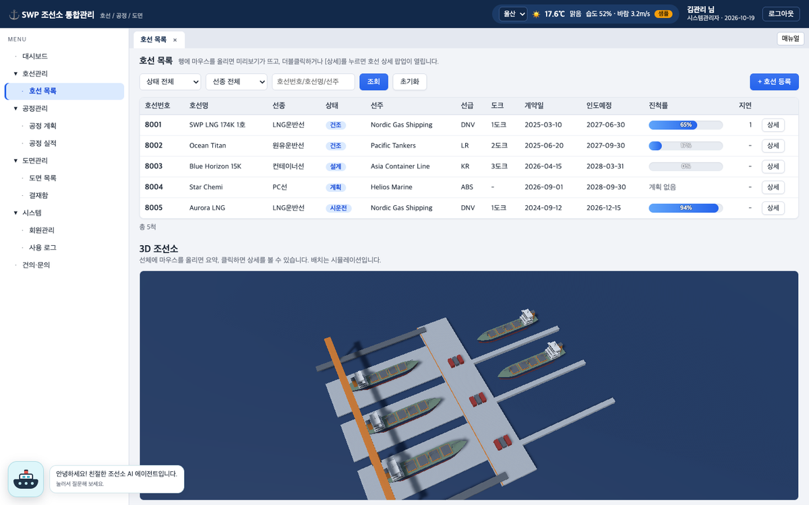

### 4. 공정 계획 (간트)

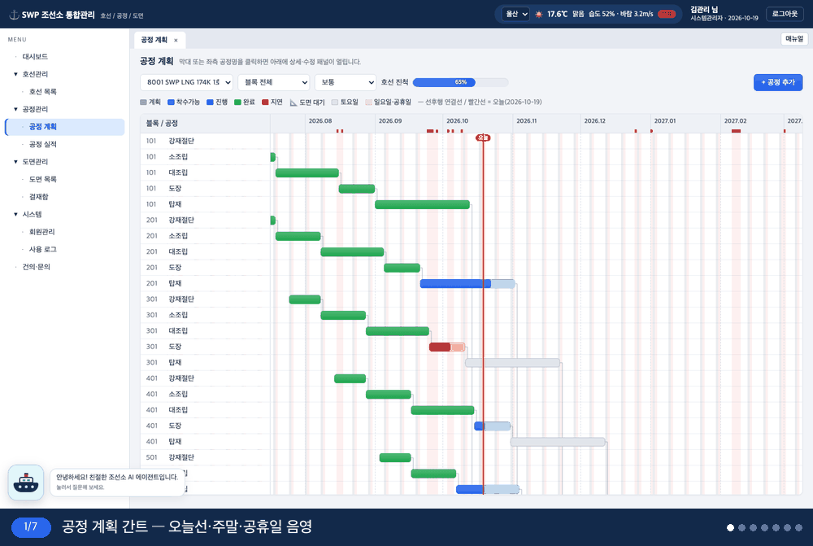

- **간트 차트**: 호선·블록 필터, 배율(축소·보통·확대), 호선 진척률, **오늘선**, 토요일·일요일·공휴일 음영(2025~2027 공휴일 표, 대체공휴일·선거일 포함).
- 상태 색상: 계획 · 착수가능 · 진행 · 완료 · 지연 · 도면 대기. 막대 끝에 진척률 표시.
- **호버 카드**: 계획/실적 기간, 진척률, 담당자, 선행·후행 공정, 연계 도면. 호버한 공정의 **선후행 연결선을 강조**한다.
- **공정 선택 → 아래 편집 패널**: 블록·공정·계획 기간·담당자·선행 공정(다중 선택)·비고 수정, 연계 도면 추가/해제(필수·참고 구분).
- **드래그로 일정 변경 + 연쇄 이동**: 막대를 끌면 저장되고, 후행 공정이 겹치면 **함께 밀린다**(예: A를 6일 늦추면 B·C가 순서대로 이동, 무관한 공정은 그대로). 선행보다 앞으로 당기면 409와 확인 단계를 거친다.
- **도면 게이트**: 필수 도면이 배포되기 전에는 착수할 수 없고, 패널에 `착수 대기 — 필수 도면 미배포` 안내와 해당 도면 링크가 나온다(링크 클릭 시 도면 상세 모달).

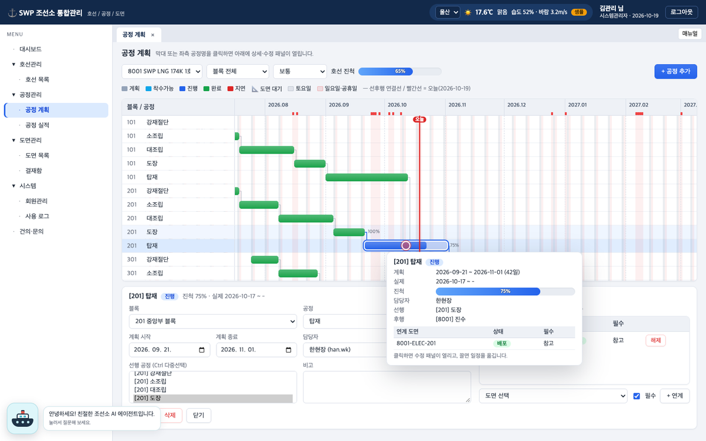

### 5. 공정 실적

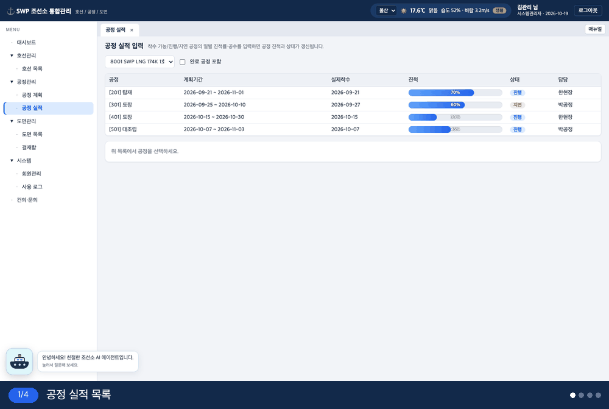

- 진행 중 공정 목록(완료 포함 토글), 행 호버 미리보기 카드.
- 공정을 고르면 **일자별 누적 진척률 입력**. 같은 날 다시 저장하면 1건으로 갱신, 미래일·계획 범위 밖·빈 값은 거절.
- 100%를 입력하면 상태가 **완료(DONE)** 로 바뀌고 실제 종료일이 기록된다. 그 실적을 지우면 이전 상태로 돌아간다.
- 대시보드·간트·호선 진척률에 즉시 반영.

### 6. 도면 관리

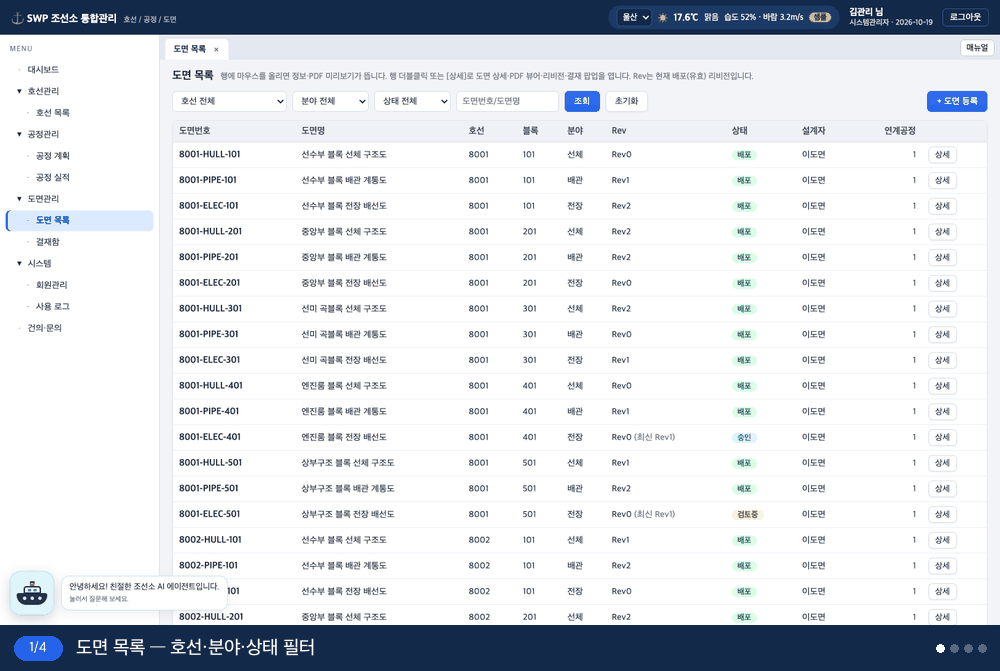

- **도면 목록**: 호선·분야(선체·전장·배관)·상태 필터, 검색, Current Rev와 최신 Rev 표기.
- **호버 카드에 PDF 첫 장 미리보기.**
- **도면 상세 모달**
  - 왼쪽 **PDF 뷰어**(Rev 선택, 새 창 열기). 파일이 없으면 `샘플`임을 명시.
  - **리비전 이력**: Rev별 상태(작성중 DRAFT → 검토중 → 승인 → 배포 ISSUED → 폐기 OBSOLETE), 변경 사유, 파일, 배포일.
  - **결재 이력**: 단계(검토/승인)·결재자·결과.
  - **연계 공정**: 이 도면이 걸린 공정과 필수/참고 구분, 필요일.
- **신규 도면 등록**: Rev0 DRAFT로 생성. 다른 호선의 블록 지정 거절, 등록 후 호선 변경 불가.
- **PDF 업로드**: PDF만, 30MiB 이하, **DRAFT Rev에서만** 업로드·교체·삭제 가능(UI도 DRAFT일 때만 활성).
- **신규 Rev 작성 → 결재 요청 → 배포**: 배포되면 이전 ISSUED는 OBSOLETE, CurrentRevNo 갱신, 연계 공정의 도면 게이트가 풀려 **착수가능(READY)** 이 된다. 이미 진행 중인 공정에 영향이 있으면 경고.

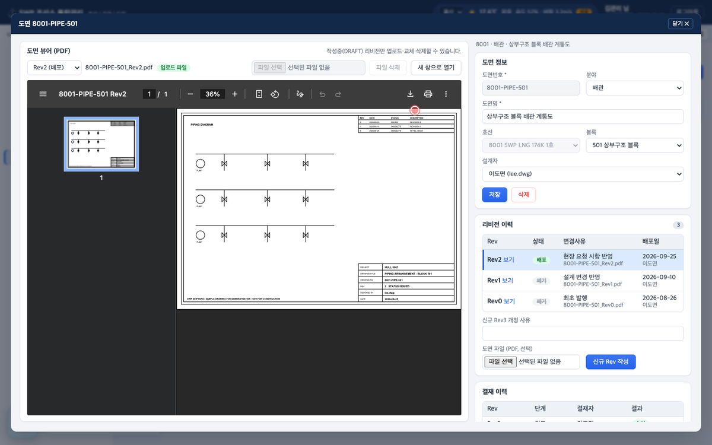

### 7. 결재함

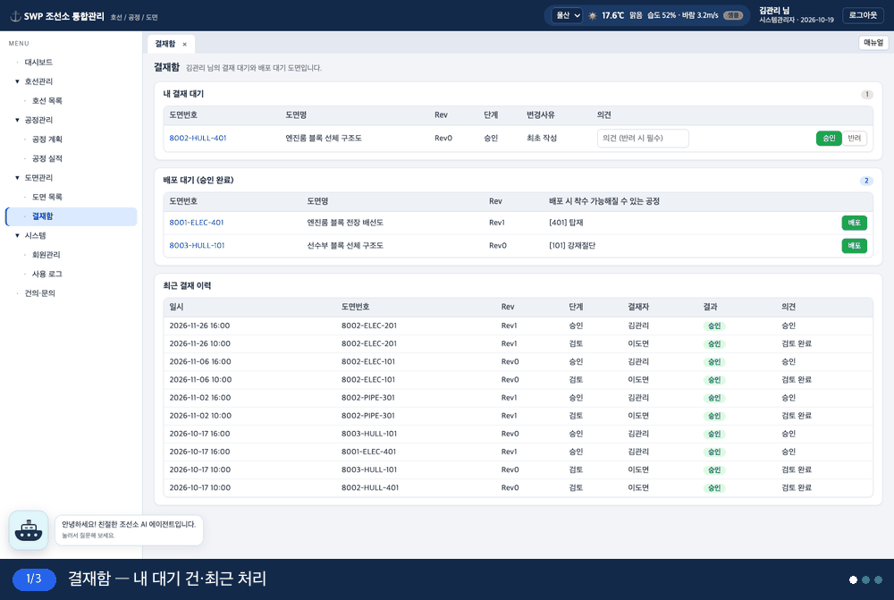

- 내 앞으로 온 **대기 건**과 **최근 처리 10건**.
- **2단계 순차 결재**: 1단계(검토)가 끝나기 전에는 2단계(승인) 결재자에게 대기 건이 생기지 않는다. 지정되지 않은 사용자의 결재는 거절.
- **반려는 의견 필수** — 반려하면 Rev가 DRAFT로 돌아가고 대기 건은 사라지지만 반려 이력은 남는다.
- 양 단계 승인 시 APPROVED, 이후 배포하면 도면·공정 상태가 갱신된다.

### 8. 회원관리 · 메뉴 권한

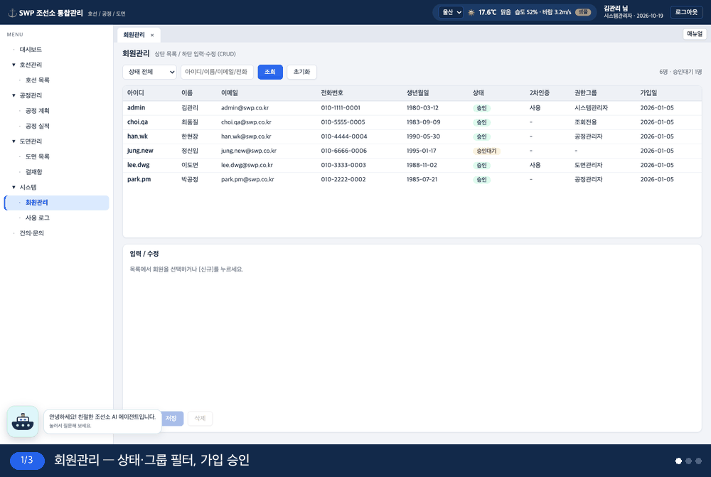

- 회원 목록(상태·그룹 필터), **가입 승인/반려/중지**, 그룹 변경(즉시 반영), 신규 등록, 비밀번호 재설정(비우면 기존 해시 유지).
- **OTP 설정**: secret은 응답에 노출하지 않고, 미등록 상태에서 OTP 켜기는 409.
- **회원별 메뉴 권한 표**: 메뉴마다 None / View / Edit / Admin. **회원별 값이 그룹 권한보다 우선**(올리기·내리기·막기 모두 가능), 그룹과 같은 값은 저장하지 않고, 비우면 그룹 권한으로 돌아간다. 관리자 본인 잠금(409)·비관리자 접근(403) 방지.
- 권한 판정은 백엔드의 **단일 함수(BR-10)** 하나가 메뉴·API·MCP 모두에 쓰인다.

### 9. 사용 로그

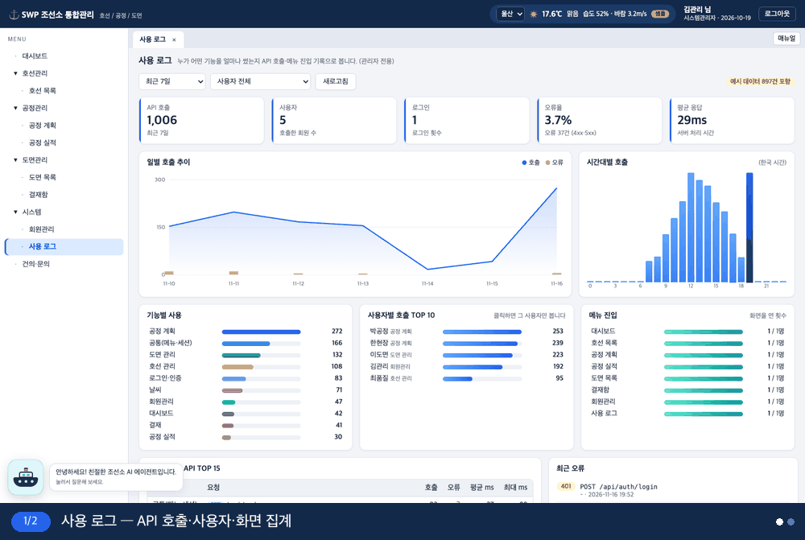

- 인증된 API 호출을 **사용자·경로 템플릿** 단위로 기록(health 체크 제외).
- 기간(최근 7/30/90일)·사용자 필터.
- KPI: API 호출 · 사용자 수 · 로그인 횟수 · 오류율(4xx·5xx, 5% 이상 강조) · 평균 응답 ms(500ms 이상 강조).
- 일별 호출/오류 추이, 시간대별 호출(한국 시간), 기능별 사용, **사용자별 TOP 10**(클릭하면 그 사용자만), 메뉴 진입 횟수, API TOP 15(호출·오류·평균/최대 ms), 최근 오류.
- 예시 로그가 섞여 있으면 `예시 데이터` 배지로 구분. 관리자 전용(메뉴·API 모두 403).

### 10. 건의·문의

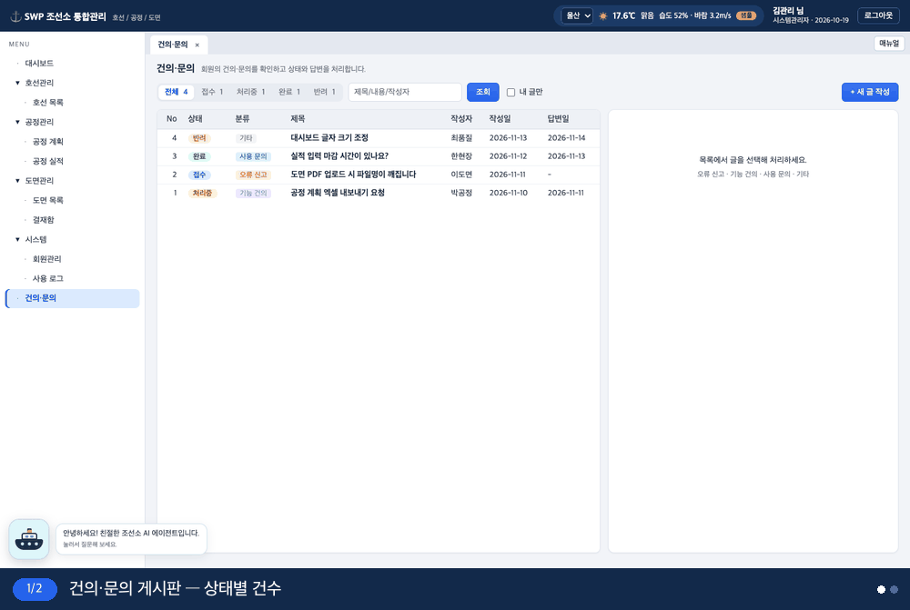

- 누구나(조회 전용 그룹 포함) 건의/문의 작성. 상태별 건수(접수·완료·반려).
- 작성자는 **OPEN 상태에서만** 수정·삭제(이후 409), 남의 글은 403.
- 관리자는 **완료/반려 + 답변 필수**로 처리하고 처리자·처리 시각이 기록된다.

### 11. 조선소 챗봇 (MCP + 로컬 LLM)

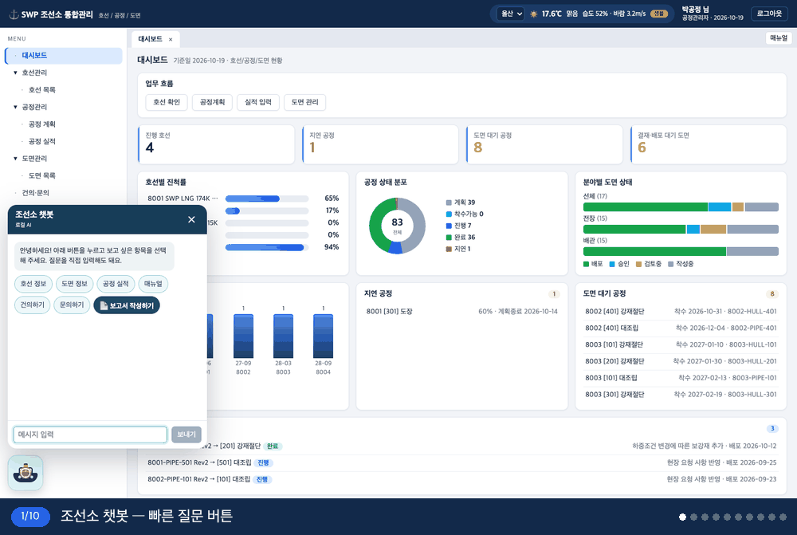

화면 오른쪽 아래 아이콘으로 여는 챗봇. **데이터 질문은 MCP 도구로만 답하고, LLM이 데이터를 지어내지 않는다.**

- **빠른 질문 버튼**: 호선 정보 · 도면 정보 · 공정 실적 · 매뉴얼 · 건의하기 · 문의하기 · 📄 보고서 작성하기.
- **자연어 라우팅**: "도면 목록 보여줘", "8001 호선" 같은 질문을 의도별 MCP 도구로 보낸다.
  | MCP 도구 | 하는 일 |
  | --- | --- |
  | `search_hulls` | 호선 번호·이름 검색(최대 20척) → 호선 카드 |
  | `list_drawings` | 도면 목록 → 도면 카드 |
  | `list_progress_hulls` | 공정이 있는 호선 → 공정 선택 → 최근 실적 요약 |
  | `submit_feedback` | 건의·문의 접수(멱등 request_id) → 게시판에 글 생성, 접수번호 FB-… |
  | `build_report` | 호선·공정·도면 현황 보고서 생성 |
- **결과 카드 클릭 → 상세 모달**(호선 상세, 도면 상세). 카드에도 마우스오버 미리보기.
- **보고서 작성**: 호선을 고르면 **PDF(한글 글꼴)·Excel(시트 4개)** 보고서를 만들어 바로 다운로드. 권한 없는 섹션은 빠지고, 다른 사용자의 파일은 404.
- **일반 질문**("선박 블록이 뭐야?")은 이 Mac의 **Ollama(qwen2.5 1.5B)** 가 답한다. Ollama가 꺼져 있거나 모델이 없거나 바쁘면 각각 다른 안내 문구.
- **사용법 질문**("도면 사용법 알려줘")은 서버 호출 없이 업무 매뉴얼을 연다.
- MCP 서버는 사용자 사번으로 실행되는 별도 프로세스(`python -m app.hull_mcp <emp_no>`)이고, **읽기 전용 DB 연결 + 메뉴 권한 검사**를 거친다.

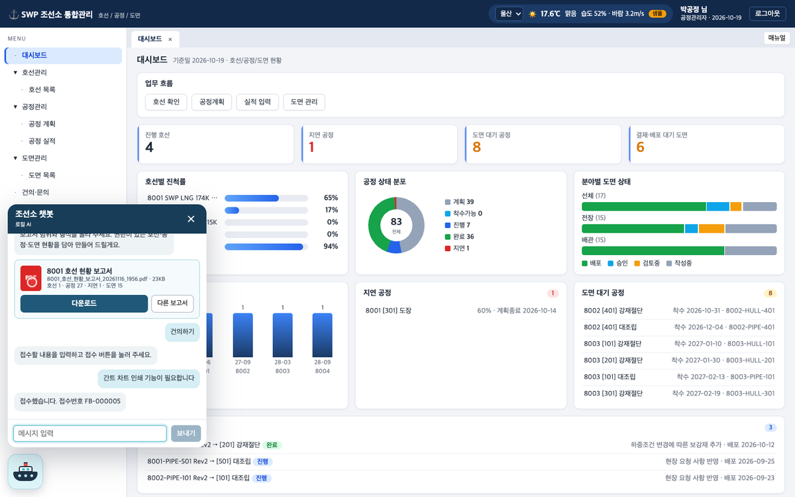

### 12. 업무 매뉴얼

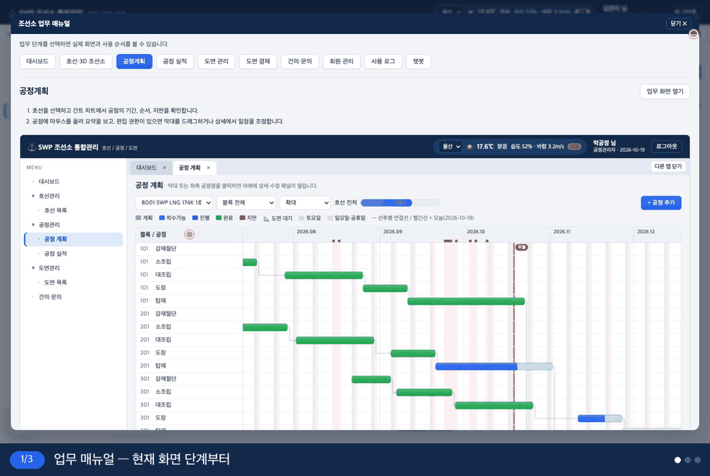

- 세 곳에서 열린다: 화면 우측 상단 `매뉴얼` 버튼, 대시보드 업무 흐름 버튼, 챗봇.
- **현재 보고 있는 화면의 단계부터** 시작하고, 단계마다 실제 화면 사진과 설명.
- 권한 없는 단계는 숨기고, `업무 화면 열기`를 누르면 매뉴얼이 닫히며 해당 탭으로 이동.

### 13. 조회 전용 권한

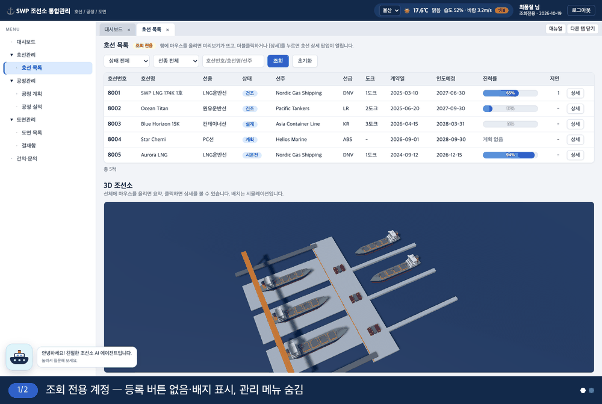

- View 등급 사용자는 등록·수정·삭제 버튼이 사라지고 `조회 전용` 배지가 붙는다. 관리 메뉴(회원관리·사용 로그·결재함)는 메뉴에서 숨긴다.
- 화면만 숨기는 게 아니라 **API도 403**으로 막는다.

### 공통 셸

- **권한 기반 메뉴 트리**(그룹 접기/펼치기), **멀티 탭**(같은 화면은 탭 하나, 최대 12개 — 13번째는 오류 후 기존 탭 유지, `다른 탭 닫기`), 새로고침해도 탭 복구(권한 없는 탭은 제외).
- **날씨 위젯**: 지역 선택(기본 울산, 거제 등 조선소 지역), 실패 시 `샘플` 배지로 대체하고 LIVE로 속이지 않는다. 늦게 온 응답은 무시.
- 모달은 Esc·닫기로 닫히고 화면을 옮기면 자동으로 닫힌다. 401이면 세션을 지우고 로그인으로.
- **시연 모드**(`scripts/demo.sh`): 한 계정으로 역할을 바꿔 가며 시연(전환 시 이전 토큰 무효).

---

## 아키텍처

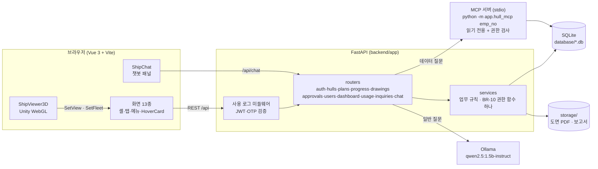

| 영역 | 경로 | 설명 |
| --- | --- | --- |
| 백엔드 | `backend/app/` | `main.py`(앱) · `routers/`(HTTP) · `services/`(업무 규칙) · `permissions.py`(BR-10 단일 권한 함수) · `hull_mcp.py`(MCP 서버) · `cli.py`(`init-db --seed --demo-pdfs --demo-usage`) |
| 프론트 | `frontend/src/` | `views/`(로그인·셸) · `screens/`(업무 화면) · `components/`(HoverCard·ShipChat·ShipViewer3D·WorkflowManual·ChatReport 등 공통) · `utils/unityViewer.js`(Unity 수명주기) |
| 3D | `unity/ShipyardViewer/` | 빌드 진입점 `ViewerBuild.Build` → `frontend/public/unity/` |
| 데이터 | `reference/seed/seed.json` | 메뉴 13개·사용자·호선·공정·도면 초기 데이터 |

**설계 원칙**
- 검증·권한·업무 규칙은 **백엔드가 소유**한다. 프론트는 버튼을 숨길 뿐, 막는 건 API.
- 공통 규칙은 한 곳에: 권한 판정 함수 하나, 마우스오버 카드 컴포넌트 하나.
- 챗봇의 실제 데이터는 MCP 도구 결과만 쓴다. LLM은 일반 설명만.

---

## 토큰을 아낀 방법

명세 → 코드 전체를 Claude Code(Opus)가 만들었고, 토큰은 이렇게 아꼈다.

| 항목 | 결과 |
| --- | --- |
| 세션 / 작업 | 6 세션(phase당 1개) / 30개 작업 전부 완료 |
| API 호출 | 164회 (phase당 12~38회) |
| 총 토큰 | 약 2,350만 — 이 중 **93%가 캐시 읽기**, 출력은 52만 |

- **한 phase = 한 세션.** 컨텍스트가 커지기 전에 끊고, 인계는 40줄짜리 `PROGRESS.md` + 자동 생성 `SOURCEMAP.md`(API·컴포넌트 목록)만 넘긴다.
- **판단 없는 일은 스크립트로.** 다음 작업 선택, 테스트·빌드(`verify.sh`는 요약만 출력), 서버 관리(`dev.sh`), 화면 캡처·픽셀 비교(`shots.mjs`)를 스크립트가 한다. 세션은 `start.sh claim` 출력 한 번으로 이번 phase의 작업·명세·이미지를 받는다.
- **필요한 것만 읽기.** 요구사항은 F 명세 한 곳에만 두고, 참고 이미지(장당 약 1.7K 토큰)는 해당 작업에만 붙인다.
- **응답 묶기.** 조회는 한 응답에 모으고, 파일 쓰기와 검증을 같은 응답에서 한다.
- **시행착오 메모.** 이전 구현에서 막혔던 지점을 `specs/index.md`에 적어 재시도를 줄였다.

---

## 실행

필요: macOS, Node 20+, uv(Python 3.10+), Google Chrome, Unity 6000.x + Web Build Support, Ollama.

```bash
scripts/bootstrap.sh          # 최초 1회: 도구·의존성·Playwright 설치/점검
scripts/setup-ollama.sh       # Ollama 설치·실행·모델(qwen2.5:1.5b-instruct) 준비
scripts/dev.sh up             # 백엔드 :8100 + 프론트 :5273 (--fresh: 예시 데이터 포함 새 DB)
scripts/verify.sh             # 테스트·빌드
node scripts/shots.mjs        # 화면 시나리오 캡처·비교
```

브라우저에서 `http://127.0.0.1:5273` — 시드 계정: `admin`(관리자·OTP), `park.pm`(공정), `lee.dwg`(도면·OTP), `choi.qa`(조회 전용), `jung.new`(승인 대기).

기능 소개 GIF 다시 만들기: `docs/tour-flows.json`의 흐름을 `state/shots.json`에 `phase: "TOUR"`로 넣고 `node scripts/shots.mjs --phase TOUR` → `cd backend && uv run python ../scripts/make_tour_gifs.py`.

<details>
<summary>Ollama 문제 해결</summary>

| 증상 | 해결 |
| --- | --- |
| `ollama: command not found` | `scripts/setup-ollama.sh` 또는 `eval "$(/opt/homebrew/bin/brew shellenv)"` |
| 챗봇 `로컬 모델에 연결할 수 없습니다` (503) | `ollama serve` 또는 `scripts/setup-ollama.sh` |
| 챗봇 `로컬 채팅 모델을 찾을 수 없습니다` (503) | `ollama pull qwen2.5:1.5b-instruct` |
| `address already in use` | 이미 실행 중인 서버를 그대로 쓴다. 다른 포트는 `OLLAMA_BASE_URL` |
| 첫 답변이 느림 | 첫 요청에 모델을 메모리에 올린다. 두 번째부터 빠르다 |
| 답변이 부정확 | 1.5B 모델의 한계. `OLLAMA_MODEL`로 더 큰 모델 지정 가능 |

</details>
